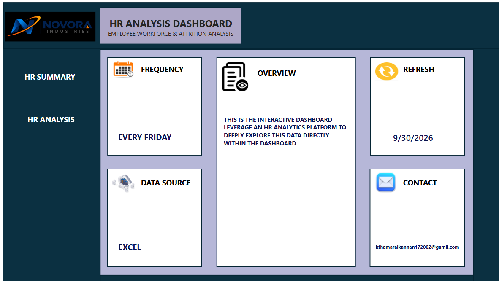

# NOVORA INDUSTRIES – HR ANALYTICS DASHBOARD
📌 Project Overview

The Novora Industries HR Analytics Dashboard is an interactive Power BI project designed to analyze employee data and provide meaningful insights into workforce distribution, 
employee headcount, and HR trends.
The dashboard helps HR teams understand employee demographics, 

monitor workforce changes, and make data-driven decisions.

🛠️ Tools & Technologies
Power BI – Dashboard Development and Data Visualization
Microsoft Excel – Data Source and Data Preparation

📊 Dashboard Pages
1. HR Summary
Provides an overview of the HR Analytics Dashboard.
Displays data source information.

Shows the latest data refresh date.

Includes dashboard navigation and contact information.

3. HR Analysis

Employee Headcount – Displays the total number of employees.

Headcount Trend – Shows employee headcount trends over time.

Gender Analysis – Compares male and female employee distribution.

Age Group Analysis – Analyzes employee distribution across different age groups.

Country Analysis – Displays employee headcount by country.

Business Unit Analysis – Shows employee distribution across departments.

Job Title Analysis – Displays employee headcount by job title.

🎯 Key Features

Interactive dashboard with multiple visualizations.

Dynamic filtering using slicers.

Employee analysis by gender, age group, country, and department.

Headcount trend analysis.

Easy-to-understand HR metrics and KPIs.

Data refresh information.

🔍 Interactive Filters

The dashboard includes the following slicers:

Date
Business Unit
Country
Employee Full Name

These filters allow users to explore employee information based on their selection.

💡 Business Insights

This dashboard helps identify:

Overall employee headcount.

Male and female employee distribution.

Workforce trends over time.

Employee distribution across different age groups.

Country-wise employee distribution.

Department-wise workforce distribution.

Job title-wise employee headcount.

📷 Dashboard Preview

HR Summary

Add your HR Summary dashboard screenshot here.

HR Analysis
![Dashboard (https://github.com/thamaraikannan1722/NOVORA-INDUSTRIES/blob/5221a042a3d31dea77329f72561e6d6dedde527f/POWER%20BI/novora%20image1.png)]
]

📁 Project Objective

The main objective of this project is to transform raw HR data into meaningful insights using Power BI. The interactive dashboard helps understand workforce dynamics and supports better HR decision-making.

📌 Skills Demonstrated

Power BI

Microsoft Excel

Data Cleaning

Data Analysis

Data Visualization

Dashboard Development

Interactive Reporting

Project Name: Novora Industries – HR Analytics Dashboard
Tools Used: Power BI | Excel
Domain: Human Resources (HR)
